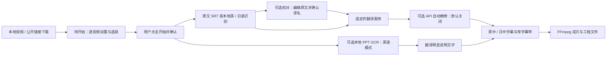

# 代码与数据目录

公开源码：

- `app/engine.py`：字幕、工作进程、翻译适配、导出与恢复。
- `app/gui.py`、`range_picker.py`：队列、下载设置、方案管理与选段。
- `app/task_workflow.py`、`anime.py`：明确启动、逐任务设置、原文校对、作品资料与译名规则。
- `app/refinement.py`：按原文校对已有译文、固定名称检查、备注过滤；精修缓存和原译分别保存。
- `app/model_assets.py`：显式下载并校验识别模型。
- `app/layout.py`、`ppt.py`：排版、PPT 筛选与注释。
- `app/profiles.py`：Windows DPAPI 配置存取。
- `app/paths.py`：源码运行与打包运行的目录定位。
- `tests/`：合成样例与离线测试。
- `scripts/`：模型校验、构建、隐私审计和源码导出。

源码模式将所有运行文件放在 `.local/runtime`，包括 bin、models、settings、exports、downloads、projects 和 cache。识别缓存按视频、范围、来源语言、模型及日文提示隔离；中文译名、翻译模型及布局不参与识别缓存。翻译缓存另外包含原文、译名表、提示词版本和翻译方案。旧的本地安装和历史资料可能暂留在其他被忽略目录；运行任务未结束前不移动它们。

进程间通过标准输入传递工作请求，通过结构化标准输出回传事件。API 凭据不作为命令行参数。API 配置持久化由 ProfileStore 单独加密处理。
